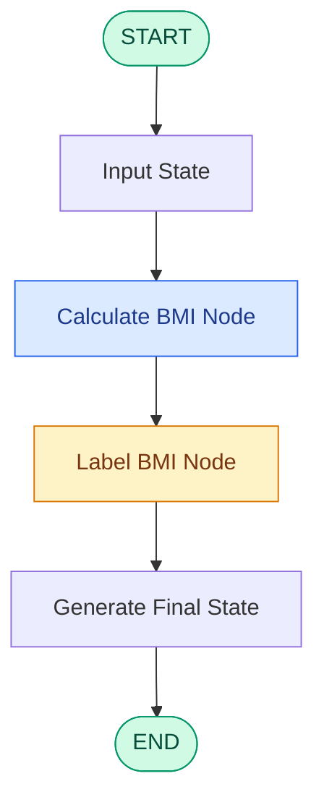

# 🧮 BMI Calculator Workflow using LangGraph

<p align="center">
  <b>A beginner-friendly exploration of graph-based workflow orchestration using LangGraph and Python.</b>
</p>

<p align="center">
  
</p>

<p align="center">
  
  
  
  
  
</p>

---

## 📌 1. Project Overview

This project demonstrates the implementation of a **sequential, non-LLM workflow using LangGraph**.

The application accepts a user's weight and height, calculates their Body Mass Index (BMI), and classifies the result into a health category.

Beyond BMI calculation, this project introduces fundamental concepts of Agentic AI architecture, including:

- Graph-based workflow orchestration.
- State management using `TypedDict`.
- Modular node-based execution.
- Directed graph edges and workflow transitions.
- Graph compilation and invocation.

The objective is to understand how LangGraph manages information and controls the execution flow between different processing nodes.

## ⚙️ 2. Workflow Architecture

The application follows a sequential execution pipeline consisting of two main processing nodes.

### Workflow Diagram



### Execution Flow

| Stage | Component | Responsibility |
|---|---|---|
| 1 | Input State | Receives weight and height |
| 2 | Calculate BMI | Computes BMI using the mathematical formula |
| 3 | Label BMI | Determines the corresponding BMI category |
| 4 | Final Output | Returns the updated state |

## 🧠 3. Understanding the Core Components

### A. State Management – `BMIState`

`TypedDict` defines the structure of information maintained throughout the workflow.

```python
from typing import TypedDict

class BMIState(TypedDict):
    weight_kg: float
    height_m: float
    bmi: float
    category: str
```

### B. Nodes

Nodes are individual Python functions responsible for executing specific tasks.

**Node 1: Calculate BMI**

Calculates BMI using weight and height.

\[
BMI = \frac{Weight(kg)}{Height(m)^2}
\]

**Node 2: Label BMI**

Classifies the calculated BMI into one of four categories:

| BMI Range | Category |
|---|---|
| Below 18.5 | Underweight |
| 18.5 – 24.9 | Normal |
| 25 – 29.9 | Overweight |
| 30 and above | Obese |

### C. Edges

Edges define the execution sequence between nodes.

```text
START
  |
  v
calculate_bmi
  |
  v
label_bmi
  |
  v
END
```

### D. StateGraph

`StateGraph` combines the state schema, nodes, and edges to construct the complete workflow.

## 💻 4. Implementation

### Import Required Libraries

```python
from langgraph.graph import StateGraph, START, END
from typing import TypedDict
```

### Create the Graph

```python
graph = StateGraph(BMIState)
```

### Define Processing Nodes

```python
def calculate_bmi(state: BMIState) -> dict:
    weight = state["weight_kg"]
    height = state["height_m"]

    bmi = round(weight / (height ** 2), 2)

    return {"bmi": bmi}


def label_bmi(state: BMIState) -> dict:
    bmi = state["bmi"]

    if bmi < 18.5:
        category = "Underweight"
    elif bmi < 25:
        category = "Normal"
    elif bmi < 30:
        category = "Overweight"
    else:
        category = "Obese"

    return {"category": category}
```

### Add Nodes and Edges

```python
graph.add_node("calculate_bmi", calculate_bmi)
graph.add_node("label_bmi", label_bmi)

graph.add_edge(START, "calculate_bmi")
graph.add_edge("calculate_bmi", "label_bmi")
graph.add_edge("label_bmi", END)
```

### Compile the Workflow

```python
workflow = graph.compile()
```

## 🚀 5. Execution

Pass the initial state to the workflow using the `invoke()` method.

```python
initial_state = {
    "weight_kg": 80,
    "height_m": 1.73
}

final_state = workflow.invoke(initial_state)

print(final_state)
```

### Expected Output

```python
{
    'weight_kg': 80,
    'height_m': 1.73,
    'bmi': 26.73,
    'category': 'Overweight'
}
```

The workflow calculates the BMI and automatically passes the updated state to the next node for classification.

## 📊 6. Graph Visualization

LangGraph provides graph visualization capabilities to inspect the workflow structure.

Use:

```python
print(workflow.get_graph().draw_ascii())
```

This displays the graph structure in the notebook output.

You can also use Mermaid diagrams to visualize the sequence of execution.

## 🛠️ 7. Tech Stack

| Technology | Purpose |
|---|---|
| Python | Core programming language |
| LangGraph | Graph-based workflow orchestration |
| TypedDict | State structure and type annotations |
| Jupyter Notebook | Interactive development and execution |

## 📂 8. Repository Structure

```text
non_llm_based_sequential_workflow/
│
├── 1_bmi_workflow.ipynb
├── README.md
└── bmi-workflow-overview.png
```

## 🔧 9. Getting Started

### Clone the repository

```bash
git clone https://github.com/priyanshukr001/non_llm_based_sequential_workflow.git
```

### Navigate to the project

```bash
cd non_llm_based_sequential_workflow
```

### Create a virtual environment

```bash
python3 -m venv .venv
```

### Activate the environment (Mac/Linux)

```bash
source .venv/bin/activate
```

### Install dependencies

```bash
python -m pip install langgraph jupyter ipykernel
```

### Open the notebook

```bash
jupyter notebook 1_bmi_workflow.ipynb
```

## 🎯 10. Key Learning Outcomes

Through this project, I explored:

- Implementing sequential workflows using LangGraph.
- Understanding the role of `StateGraph` and `TypedDict`.
- Designing modular processing nodes.
- Managing shared state across multiple nodes.
- Connecting nodes using directed edges.
- Compiling and invoking graph-based workflows.
- Visualizing workflow execution architecture.

## 🔮 11. Future Scope

This introductory workflow can be extended into more sophisticated applications by introducing:

- Conditional edges and branching workflows.
- LLM integration and structured outputs.
- Tool calling and external API integration.
- Persistent state and memory.
- Human-in-the-loop workflows.
- Multi-agent orchestration using LangGraph.

## 👨‍💻 Author

**Priyanshu Kumar**

Delhi Technological University (DTU)

GitHub: [@priyanshukr001](https://github.com/priyanshukr001)

---

⭐ If you find this project useful, feel free to explore the notebook and follow my journey into Agentic AI and intelligent workflow development.
